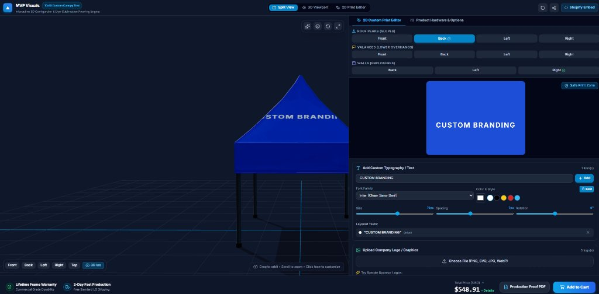
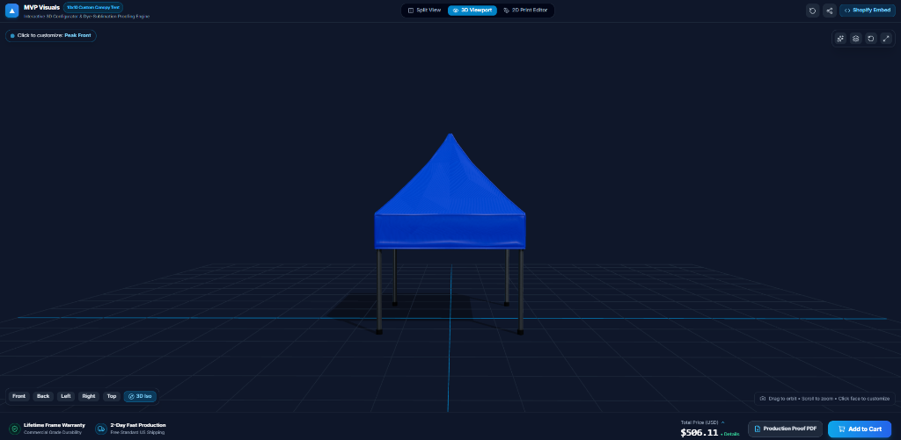
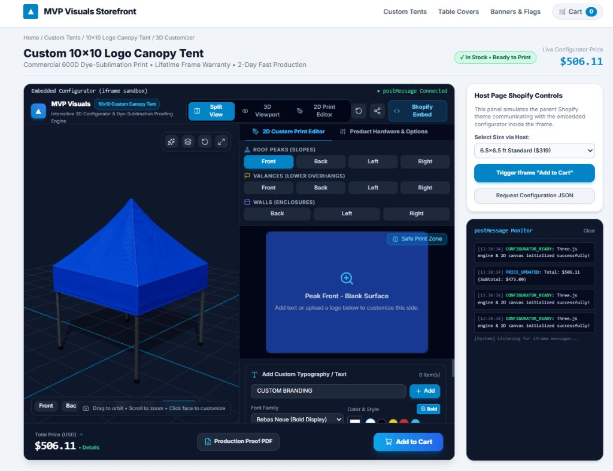

# 🏕️ Interactive 3D Product Configurator — Custom Canopy Tent

> **Technical Assessment for Vertical 3D Tech**  
> **Reference Product:** [MVP Visuals 10x10 Custom Canopy Tent](https://mvpvisuals.com/products/10x10-custom-canopy-tent)  
> **Built with:** React 18, TypeScript, Three.js, Vite, Tailwind CSS, jsPDF  
>  
> 🌐 **Live Demo:** [https://assessment-test-three-js-vertical-3.vercel.app/](https://assessment-test-three-js-vertical-3.vercel.app/)  
> 🛒 **Shopify Iframe Simulator Demo:** [https://assessment-test-three-js-vertical-3.vercel.app/embed-demo](https://assessment-test-three-js-vertical-3.vercel.app/embed-demo)

---

## 🌟 Executive Overview

This project is a high-performance, production-grade **3D Interactive Product Configurator** designed for custom canopy tents. It features real-time **2D-to-3D synchronization**, dynamic **Shopify Cart AJAX API integration**, asynchronous **pricing calculations**, **iframe postMessage embedding**, and automated client-side **production proof PDF generation**.

### 🎯 Key Evaluation Highlights
* **Replication of Reference:** Faithful reproduction of the MVP Visuals custom canopy tent workflow (Peaks, Valances, Frame finishes, Wall packages, Hardware accessories).
* **True 2D/3D Bidirectional Sync:** Edit typography, logos, scale, rotation, and colors on a 2D cut template with instantaneous 60 FPS Three.js canvas texture updates. Clicking on any 3D tent surface via Three.js Raycasting automatically pivots the camera and opens that section in the 2D editor.
* **Shopify E-commerce Integration:** Full compliance with the Shopify Cart AJAX API (`POST /cart/add.js`), line item properties, and storefront events. Includes an interactive Shopify Cart Drawer with live API payload inspection.
* **Embeddable via Iframe:** Designed to be embedded into any Shopify theme or CMS with a bidirectional `postMessage` protocol (testable live via `/embed-demo.html`).
* **Automated Production Proof PDF:** Generates high-resolution client-side PDFs featuring 3D perspective renders, master unrolled dye-sublimation print layouts, Bill of Materials (BOM), and itemized order breakdowns.
* **Modular & Reusable Architecture:** Zero hard-coding — product schemas, section definitions, UV tile maps, and pricing rules are decoupled and extensible to other customizable merchandise (flags, table covers, banners).

---

## 📸 Application Screenshots & Live Previews

### 1. Split View: Real-Time 2D Canvas & 3D WebGL Synchronization

*Figure 1: Split View mode demonstrating bidirectional 2D/3D synchronization. Custom typography ("CUSTOM BRANDING") placed on the 2D canvas cut template instantly reflects onto the 3D canopy peak with dynamic pricing updating to \$548.91 in real time.*

---

### 2. Full 3D Interactive Viewport

*Figure 2: Fullscreen 3D Viewport featuring PBR metallic frame finishes, realistic fabric shading, soft directional contact shadows, camera presets (Front, Back, Left, Right, Top, 3D Iso), and 360° auto-rotation.*

---

### 3. Shopify Storefront Iframe Embedding & `postMessage` Bridge

*Figure 3: Interactive Shopify Storefront PDP simulator (`/embed-demo.html`). Demonstrates the configurator embedded seamlessly in an iframe, exchanging bidirectional postMessage events with the host store for size changes, live pricing, and cart additions.*

---

## 🚀 Quick Start & Live Demo

### 🌐 Live Production Deployment
* **Live 3D Configurator:** [https://assessment-test-three-js-vertical-3.vercel.app/](https://assessment-test-three-js-vertical-3.vercel.app/)
* **Shopify Storefront Iframe Simulator:** [https://assessment-test-three-js-vertical-3.vercel.app/embed-demo](https://assessment-test-three-js-vertical-3.vercel.app/embed-demo)

### 1. Prerequisites
* **Node.js**: v18.0.0 or higher
* **npm**: v9.0.0 or higher

### 2. Installation & Run
```bash
# Clone the repository
git clone <repo-url>
cd "Assessment Test – Three.js [ Vertical 3d Tech ]"

# Install dependencies
npm install

# Start development server
npm run dev
```

Visit the local development server:
* **Main Configurator:** [http://localhost:3000](http://localhost:3000)
* **Shopify Iframe Embed Simulator:** [http://localhost:3000/embed-demo.html](http://localhost:3000/embed-demo.html)

### 3. Production Build & Typecheck
```bash
npm run build
npm run preview
```

---

## 🏗️ Architecture & Key Technical Decisions

```
src/
├── components/
│   ├── editor/                # 2D Interactive Canvas Editor & Tools
│   │   ├── Canvas2DEditor.tsx # Offscreen 2D canvas, handles, rulers, safe zones
│   │   ├── EditorTabs.tsx     # Roof Peaks, Valances, and Wall section switcher
│   │   ├── ImageUploadTool.tsx# Logo upload, sample sponsor logos, scale/rotate
│   │   ├── TextTool.tsx       # Typography, fonts, colors, letter spacing, bold
│   │   └── SectionColorPicker.tsx # Custom background overrides
│   ├── panels/
│   │   └── ProductOptionsPanel.tsx # Sizes (5x5, 6.5x6.5, 8x8), Frames, Walls, Add-ons
│   ├── pricing/
│   │   └── PricingBar.tsx     # Persistent dynamic price bar & itemized popover
│   ├── shopify/
│   │   └── ShopifyCartDrawer.tsx # Slide-out cart drawer, line item properties, API viewer
│   └── viewport/
│       └── ThreeViewport.tsx  # Three.js scene, OrbitControls, raycasting, camera tweening
├── constants/
│   └── productData.ts         # Tent specifications, UV coordinates, fonts, color palettes
├── services/
│   ├── pdfService.ts          # jsPDF production proof generation engine
│   ├── pricingService.ts      # Asynchronous pricing calculator & caching layer
│   ├── shopifyService.ts      # Shopify Cart AJAX API & property serialization
│   └── textureCompositor.ts   # 2048x2048 master texture compositing engine
├── types/
│   └── configurator.ts        # Strongly-typed TypeScript interfaces
├── App.tsx                    # Top-level state coordinator & postMessage bridge
└── main.tsx                   # React root entrypoint
```

---

## 🔬 Core Technical Implementations

### 1. 2D-to-3D Real-Time Texture Synchronization
The primary technical challenge in 3D product configurators is ensuring that 2D raster edits (text and images) map onto complex 3D meshes without distortion, stretching, or seam misalignments.

* **Planar UV Remapping Algorithm:** Rather than relying on irregular, skewed UV unrolls from 3D modeling packages, `ThreeViewport.tsx` dynamically inspects the canopy geometry on load and computes normalized planar coordinates for each face:
  $$\text{Apex Rim: } Y_{\text{rim}} = Y_{\text{min}} + (Y_{\text{max}} - Y_{\text{min}}) \times 0.22$$
  * Peak vertices ($Y \ge Y_{\text{rim}}$) and Valance vertices ($Y < Y_{\text{rim}}$) are partitioned by normal and position into Front ($+Z$), Back ($-Z$), Right ($+X$), and Left ($-X$).
  * Each vertex's UV is remapped to its designated rectangular quadrant on the 2048x2048 master texture map.
* **Sub-Millisecond Offscreen Compositor:** `TextureCompositor.ts` maintains individual offscreen canvases for each section. When an element is dragged or edited, only that section redraws before being stamped onto the master canvas.
* **Render Loop Efficiency:** Updates are scheduled via `requestAnimationFrame` with a dirty flag, ensuring `masterTexture.needsUpdate = true` is only dispatched once per frame, sustaining a steady 60 FPS.

### 2. Raycasting & Two-Way Interaction
* Clicking or hovering on any peak slope or valance skirt in the 3D viewport fires a raycast intersection against the fabric mesh.
* The hit coordinate is converted to local space to determine the targeted section (e.g. `peak_front`), which automatically selects that section in the 2D editor and smoothly tweens the camera angle to face it head-on.

### 3. Dynamic Pricing Architecture
* `PricingService.ts` operates as a decoupled, asynchronous service simulating a real e-commerce API endpoint (with mock network latency and `AbortController` cancellation).
* **Pricing Factors:**
  1. **Base Size:** 5x5 ft (\$249), 6.5x6.5 ft (\$319), 8x8 ft (\$389).
  2. **Frame Upgrade:** Powder-coated Steel (\$0), Anodized Aluminum (+\$85), Heavy-Duty Hex Pro (+\$165).
  3. **Custom Peak Printing:** Calculated dynamically at \$40 per printed peak face.
  4. **Custom Valance Printing:** Calculated dynamically at \$25 per printed valance overhang.
  5. **Wall Enclosures:** Solid Back Wall (+\$89), Panoramic Window Wall (+\$115), Half Walls (+\$49 each).
  6. **Hardware Accessories:** Heavy-Duty Sandbags (\$45), Roller Travel Case (\$69), LED Perimeter Lights (\$55), Flag Mounts (\$39).
* Returns an itemized breakdown including subtotal, tax estimate, and free commercial ground shipping.

### 4. Shopify Cart Integration (`/cart/add.js`)
When the customer clicks **Add to Cart**, `ShopifyService.ts` formats the exact payload required by the Shopify AJAX Cart API:

```json
{
  "items": [
    {
      "id": 420202,
      "quantity": 1,
      "properties": {
        "_config_id": "CFG-9B2X4A",
        "Tent Size": "6.5 x 6.5 ft Standard",
        "Frame Type": "Anodized Aluminum Frame",
        "Canopy Color": "Royal Blue (#1d4ed8)",
        "Custom Printed Sections": "PEAK FRONT, VALANCE FRONT",
        "Wall Packages": "Back Wall (full)",
        "Accessories": "Pro Heavy-Duty Wheeled Roller Case",
        "Total Calculated Price": "$498.00",
        "_production_ready": "true",
        "_timestamp": "2026-11-26T07:45:00.000Z",
        "_raw_config_json": "{\"size\":\"6.5x6.5\",\"frame\":\"aluminum\",...}"
      }
    }
  ]
}
```
* Custom properties prefixed with `_` are preserved for production fulfillment and ERP/CRM webhooks while remaining clean on standard customer order confirmation screens.
* Dispatches a custom `shopify:cart:added` DOM event to trigger slide-out cart drawers in themes like Shopify Dawn.

### 5. Iframe Embedding & `postMessage` Protocol
The configurator is fully responsive and embeddable into external sites:
```html
<iframe
  src="https://your-domain.com/?embed=true"
  width="100%"
  height="750px"
  frameborder="0"
></iframe>
```

#### Supported PostMessage Events:
| Direction | Event Name | Payload / Description |
|:---|:---|:---|
| **Child → Parent** | `CONFIGURATOR_READY` | Fired when Three.js scene & models are loaded |
| **Child → Parent** | `PRICE_UPDATED` | Contains dynamic `pricing` breakdown object |
| **Child → Parent** | `ADDED_TO_CART` | Contains full Shopify cart payload and properties |
| **Parent → Child** | `SET_SIZE` | Updates tent size (e.g., `{ size: '8x8' }`) |
| **Parent → Child** | `SET_CONFIGURATION`| Injects a saved configuration state |
| **Parent → Child** | `TRIGGER_ADD_TO_CART` | Triggers the cart addition sequence from the host PDP |

> 💡 **Try the Live Simulator:** Open [https://assessment-test-three-js-vertical-3.vercel.app/embed-demo](https://assessment-test-three-js-vertical-3.vercel.app/embed-demo) (or local `public/embed-demo.html`) in your browser to test parent-child message exchange in real time!

### 6. Production Proof PDF Generation
`PdfService.ts` utilizes `jspdf` to construct a pre-press proof sheet on the fly:
1. **Header Banner:** Order reference ID (`CFG-XXXXXX`), generation timestamp, and production stage.
2. **Visual Proofs:** Side-by-side inclusion of the high-res 3D perspective snapshot and the master unrolled 2048x2048 dye-sublimation print layout.
3. **Bill of Materials (BOM):** Dimensions, fabric specs (600D Poly, UV50+, PU coating), frame hardware weight & warranty, wall packages, and hardware add-ons.
4. **Printed Sections Table:** Itemized breakdown of every custom printed surface, slogan text, font family, and logo reference.
5. **Pre-Press Quality Sign-Off:** Bleed tolerances and CMYK dye-sublimation color verification note.

---

## 🧩 Reusability & Extensibility Guide

The architecture is built according to the **Open-Closed Principle**. Adding a new product (e.g., a Trade Show Table Cover or Feather Flag) requires no core engine rewrites:

```typescript
// Example: Adding a Table Throw product schema in src/constants/tableData.ts
export const TABLE_PRODUCT: ProductDefinition = {
  id: 'table-throw-6ft',
  name: '6ft Fitted Custom Table Cover',
  defaultModel: '/models/table_6ft.glb',
  basePrice: 169,
  sections: [
    { id: 'table_front', name: 'Front Drape', uvBounds: { uMin: 0, uMax: 0.5, vMin: 0.5, vMax: 1 } },
    { id: 'table_top',   name: 'Top Table Surface', uvBounds: { uMin: 0.5, uMax: 1, vMin: 0.5, vMax: 1 } },
  ],
  pricingRules: {
    customPrintFeePerSection: 25,
  }
};
```

---

## ⚡ Performance Optimizations

1. **Asset Optimization:** GLB models are statically bundled and served via Vite with Draco/mesh compression compatibility.
2. **Manual Chunk Splitting:** `vite.config.ts` partitions heavy libraries into independent vendor chunks (`three`, `jspdf`, `react`), keeping the initial bundle lean.
3. **Memory & Context Leak Prevention:** Full lifecycle management on unmount:
   * Geometries, materials, and textures call `.dispose()`
   * RequestAnimationFrame IDs are cleanly canceled
   * WebGL contexts are properly released
4. **Debounced Pricing & Offscreen Canvas:** Asynchronous pricing uses request debouncing to prevent UI thrashing during rapid user input.

---

## 📄 License & Confidentiality Notice

This project and its accompanying 3D models, assets, and documentation are prepared strictly as part of the technical evaluation for **Vertical 3D Tech** and are subject to the confidentiality requirements specified in the assessment guidelines.
